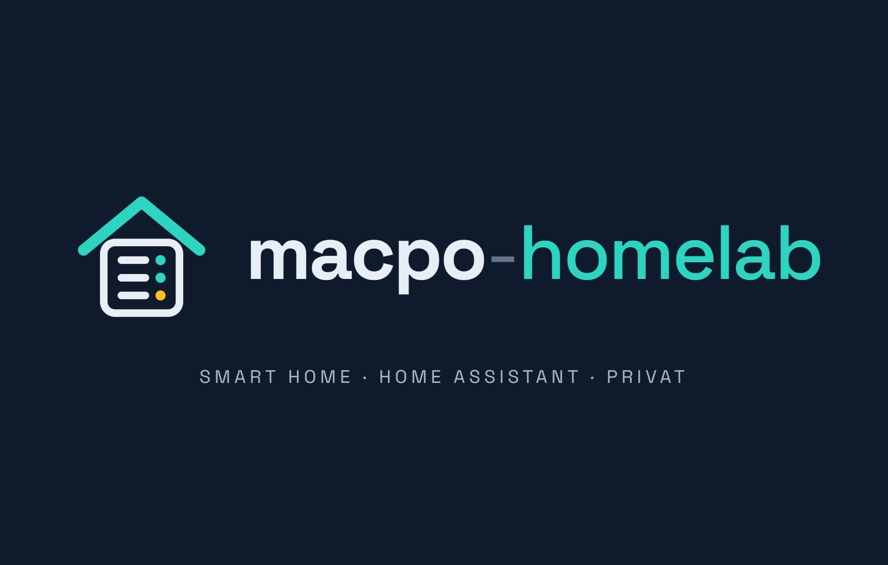

<p align="center">
  
</p>

<h1 align="center">macpo-homelab</h1>

<p align="center">
  Blueprints und Apps für <b>Home Assistant</b> aus meinem privaten Smart Home, zum Herunterladen und Mitbenutzen.
</p>

---

## Worum geht es?

Hier veröffentliche ich Bausteine aus meinem Smart Home, die auch für andere nützlich sein können:

- **Blueprints**: fertige Vorlagen für Automationen und Skripte, die du mit wenigen Klicks in Home Assistant importierst
- **Apps**: Erweiterungen für Home Assistant

Alles, was hier liegt, läuft bei mir selbst im Alltag.

## Veröffentlichungen

| Repository | Beschreibung | Aktuelle Version |
|---|---|---|
| [ha-blueprints](https://github.com/macpo-homelab/ha-blueprints) | Sammlung von Automations-Blueprints |  |
| [ha-apps](https://github.com/macpo-homelab/ha-apps) | Apps für Home Assistant |  |

## Installation

### Blueprints

Klicke im jeweiligen Repository auf den Import-Button des gewünschten Blueprints:

[](https://my.home-assistant.io/redirect/blueprint_import/?blueprint_url=https%3A%2F%2Fgithub.com%2Fmacpo-homelab%2Fha-blueprints%2Fblob%2Fmain%2FBEISPIEL.yaml)

Alternativ in Home Assistant unter **Einstellungen → Automationen & Szenen → Blueprints → Blueprint importieren** die URL der YAML-Datei einfügen.

### Apps

Füge das Repository in Home Assistant hinzu:

[](https://my.home-assistant.io/redirect/supervisor_add_addon_repository/?repository_url=https%3A%2F%2Fgithub.com%2Fmacpo-homelab%2Fha-apps)

Danach erscheinen die Apps im App-Store von Home Assistant und lassen sich dort installieren.

## Wie entwickle ich?

Die Entwicklung findet aktuell in meinem **privaten Git** statt. Hier auf GitHub erscheinen die **fertige Releases**.

```
Privates Gitea  ──►  Test im eigenen Smart Home  ──►  Release auf GitHub
(Entwicklung)        (Alltagstest)                    (öffentlich)
```

Das bedeutet für dich:

- Der Stand auf GitHub ist immer eine getestete, veröffentlichte Version.
- Die Commit-Historie auf GitHub ist bewusst kurz gehalten.
- Was sich geändert hat, steht in den **Release Notes** des jeweiligen Repositorys.

## Feedback und Mitmachen

- **Fehler gefunden oder eine Idee?** Eröffne gern ein [Issue](https://github.com/macpo-homelab/ha-blueprints/issues) im passenden Repository.
- **Pull Requests** sind willkommen. Da die Entwicklung intern läuft, übernehme ich Änderungen von Hand und veröffentliche sie mit dem nächsten Release. Du wirst dabei natürlich erwähnt.

Bitte hab Verständnis, dass dies ein privates Hobbyprojekt ist und Antworten etwas dauern können.

## Lizenz und Hinweis

Sofern im jeweiligen Repository nicht anders angegeben, stehen die Inhalte unter der [MIT-Lizenz](https://opensource.org/licenses/MIT).

Dies ist ein privates Projekt und steht in keiner Verbindung zu Home Assistant oder der Open Home Foundation. Die Nutzung erfolgt auf eigene Verantwortung.

---

<p align="center"><sub>Mit ☕ und viel YAML gebaut in meinem Homelab.</sub></p>
